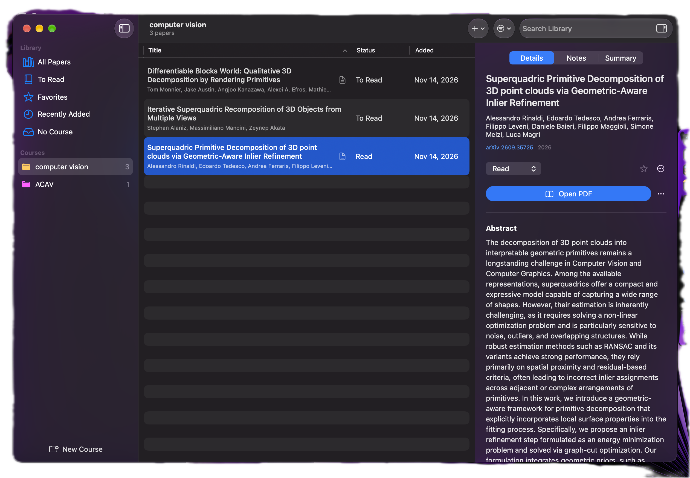

# Paper Library

Native macOS app to organize research papers into courses, import from arXiv, DOI links or local PDFs, read papers, take notes, and generate on-device AI summaries. Your library is stored locally.

DOI imports use Crossref or DataCite, with OpenAlex for missing abstracts and open PDF links. Select an existing DOI paper to recover additional details. Supported public PDFs can be downloaded in the app; **Get PDF from Publisher…** opens other copies, including papers requiring institutional access. **Attach PDF…** adds a downloaded file to the selected paper and preserves its notes and metadata.



## Requirements

- macOS 27 or later.
- Full Xcode with the macOS 27 SDK (verified with Xcode 27.2); Command Line Tools alone are insufficient.
- AI features: **Apple silicon M1 or later**, with Apple Intelligence enabled, its model downloaded, and device/Siri set to the same supported language.
- On macOS 27, **AFM 3 Core Advanced** requires **M3 or later and at least 12 GB unified memory**.

## Installation

Download or clone this repository, open Terminal in the project folder, and run:

```sh
bash Scripts/build-app.sh release
open "build/release/Paper Library.app"
```

To update, quit the app and repeat these commands. Your library stays in `~/Library/Application Support/local.paperlibrary.app/`.

Verify the project with `bash Scripts/verify.sh`. See [ARCHITECTURE.md](ARCHITECTURE.md) and [Documentation](Documentation/) for details.
